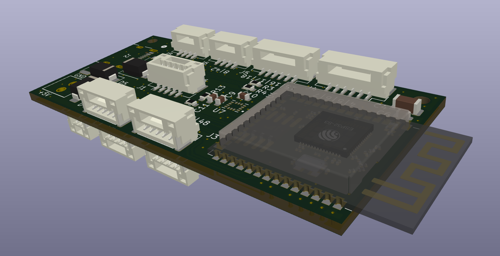

# ESP32-S3 Flight Controller

A flight-controller board built around the
ESP32-S3-WROOM-1-N16R8 module and an ICM-42686-P six-axis IMU. The repository
contains the complete KiCad design files and manufacturing outputs needed to
inspect, modify, or assemble the board.

## Hardware overview

- ESP32-S3-WROOM-1-N16R8 module with 16 MB flash and 8 MB PSRAM
- ICM-42686-P three-axis gyroscope and three-axis accelerometer
- USB-C connection for power and native USB programming
- 5 V input with onboard 3.3 V regulation
- JST-GH connections for SPI, I2C, UART, power, and GPIO
- BOOT and RESET controls
- Four-layer PCB design

## Repository contents

- `ESP32-IMU.kicad_pro` - KiCad project
- `ESP32-IMU.kicad_sch` - schematic
- `ESP32-IMU.kicad_pcb` - PCB layout
- `ESP32-IMU.csv` - exported bill of materials
- `gerbers-and-bom/Gerbers.zip` - packaged manufacturing files
- `gerbers-and-bom/Gerbers/` - Gerbers, drill files, placement data, and
  PCBWay-formatted BOM

The design was created with KiCad 10.

## Programming

The ESP32-S3 can be programmed directly through the board's USB-C connector.

Alternatively, an external CP2102 USB-to-UART adapter can be connected to the
UART0 header. When using UART0 exclusively for programming, the USB connector
and its associated USB protection components do not need to be populated. Make
sure the adapter uses 3.3 V logic levels and connect TX to RX, RX to TX, and GND
to GND.

## Manufacturing

Gerbers, drill files, component placement data, and the BOM
are available in [`gerbers-and-bom/Gerbers/`](gerbers-and-bom/Gerbers/). A
ready-to-order copy of the project is also available on
[PCBWay](https://www.pcbway.com/project/shareproject/ESP32_IMU_kicad_pcb_3eb42851.html).

Review the fabrication outputs and assembly options before ordering, especially
if components are intentionally left unpopulated.

## Disclaimer

This is an experimental hardware design. Review the schematic, PCB layout,
component ratings, and power connections before assembly. Test the completed
board safely on the bench before using it.

## License

This hardware design and its associated design files are licensed under the
[CERN Open Hardware Licence Version 2 - Permissive
(CERN-OHL-P-2.0)](LICENSE).
